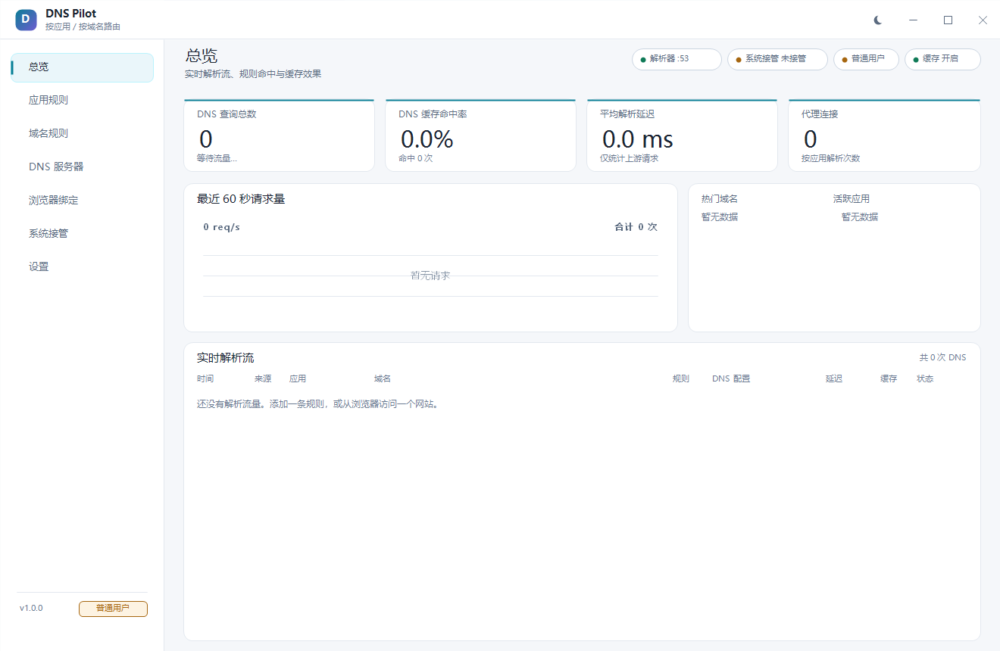
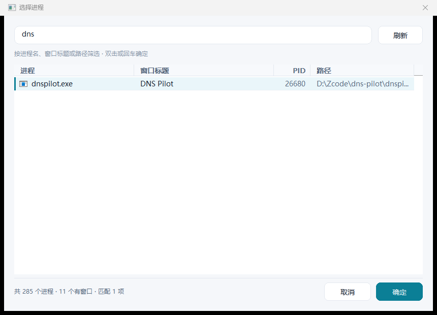
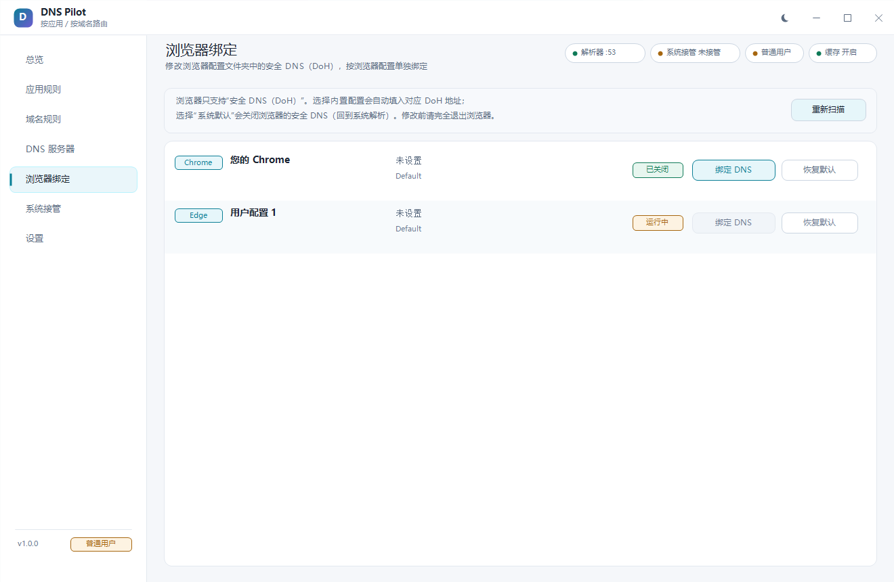
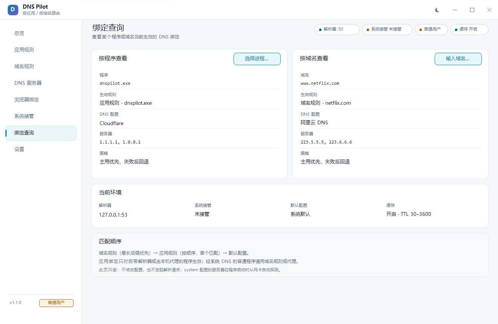
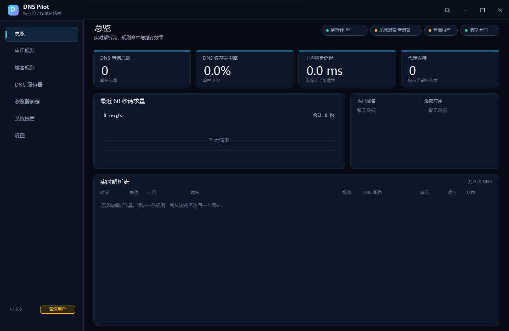
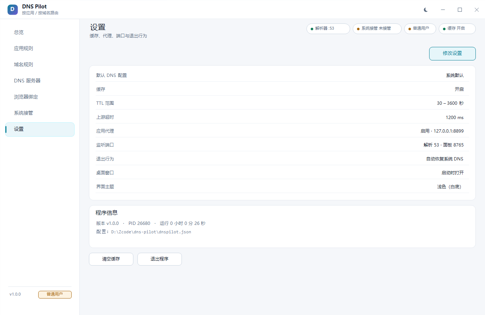
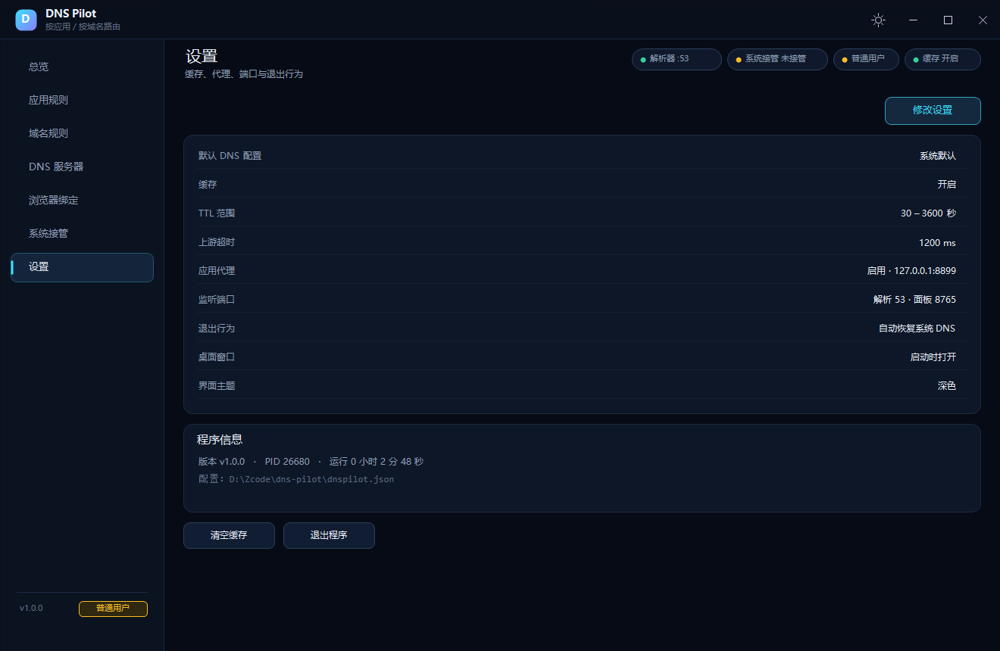
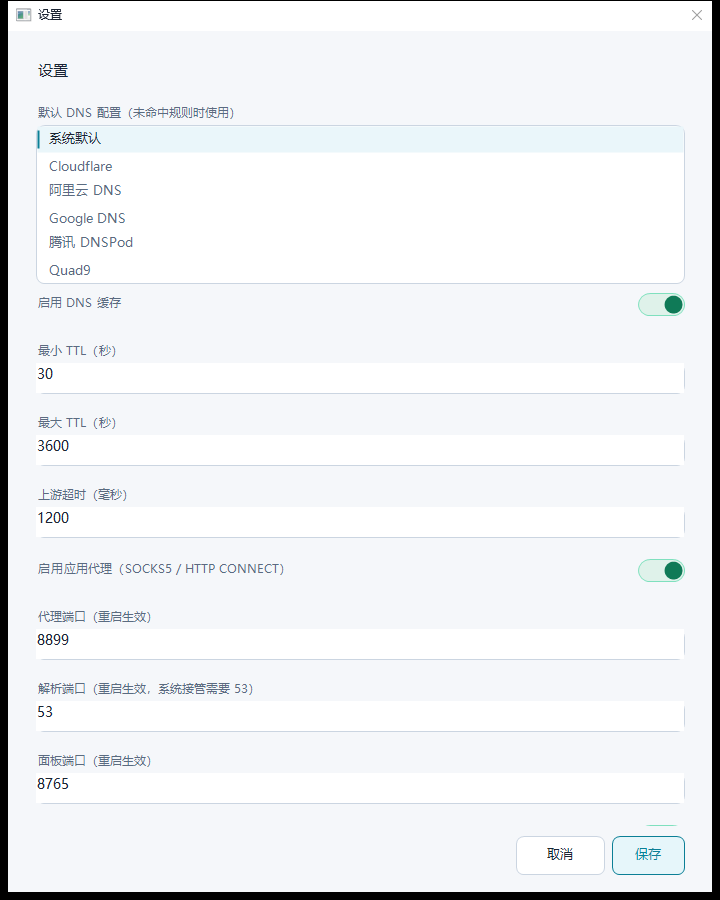
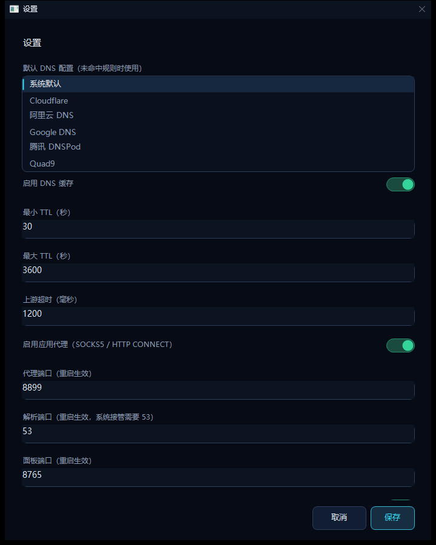
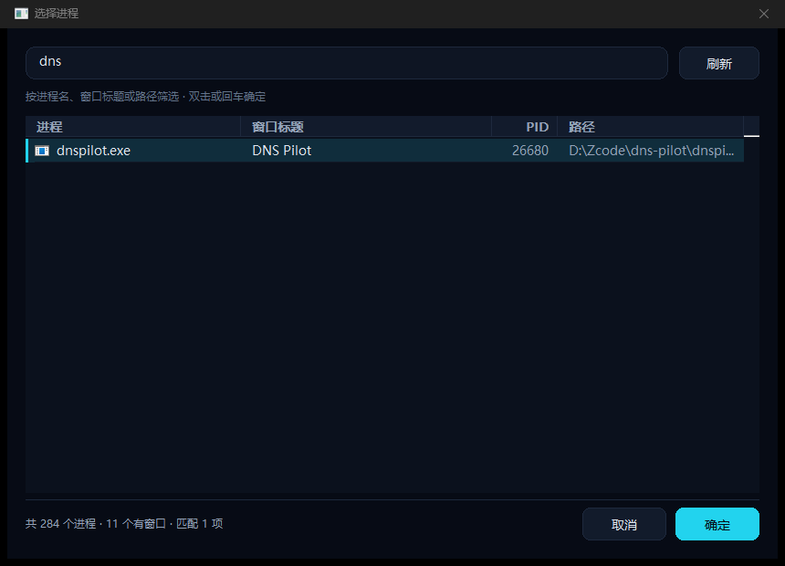

# DNS Pilot

> 让**指定的应用**、**指定的网站**或**指定的浏览器配置**优先使用某个 DNS，并提供原生桌面可视化。

- **原生 Win32 桌面应用**：C++17 + GDI+，浅色/深色双主题；不使用 WebView、Electron 或浏览器内核。
- 进程选择器按 **OBS 的方式**列出当前运行中的进程（图标、窗口标题、PID、路径），搜索 / 双击即可选中。
- 单文件 `dnspilot.exe`，无第三方运行时；另带一个可选的本地 Web 面板（手机/远程查看用）。
- **绑定查询**：选一个正在运行的程序，或输入域名/网址，直接查看它当前生效的规则与 DNS 服务器。



## 快速开始

```bat
:: 构建（只需一次；需要 Python 3.8+）
python -m pip install ziglang
build.cmd

:: 启动（默认打开原生桌面窗口）
run.cmd
```

首次启动会监听 `127.0.0.1:53`（解析器）与 `127.0.0.1:8899`（应用代理），并打开桌面窗口。

1. **应用规则** → 「选择进程添加」→ 在进程列表里选中目标程序 → 选择 DNS 配置 → 保存。
2. **域名规则** → 输入域名（如 `netflix.com`）→ 选择 DNS 配置 → 保存。
3. 想让规则**单独绑定**自己的 DNS 服务器：在规则对话框里打开「使用自定义 DNS 服务器」，填写服务器列表即可（会生成该规则专用的配置）。
4. 需要全局生效：**系统接管** → 「以管理员身份重启」→ 接管系统 DNS。
5. 绑定浏览器配置文件夹：**浏览器绑定** → 选择 Chrome/Edge/Firefox 的某个 profile → 「绑定 DNS」。

## 界面

| 页面 | 内容 |
| --- | --- |
| 总览 | 查询总数、缓存命中率、平均延迟、代理连接、60 秒曲线、热门域名/应用、实时解析流 |
| 应用规则 | 规则列表；OBS 式进程选择器；每条规则可单独绑定自定义 DNS 服务器 |
| 域名规则 | 域名后缀匹配（含所有子域） |
| DNS 服务器 | 配置增删改、服务器列表、主用+回退 / 仅主用 |
| 浏览器绑定 | 直接修改浏览器配置文件夹中的安全 DNS（DoH），按浏览器 profile 单独绑定 |
| 系统接管 | 接管/恢复系统 DNS、提权重启、网卡 DNS 现状 |
| 绑定查询 | 选择运行中的程序或输入域名/网址，查看当前生效的规则、DNS 配置、服务器与策略（只读） |
| 设置 | 默认配置、缓存/TTL/超时、代理开关与端口、退出恢复、桌面窗口、界面主题 |





## 主题

默认使用**浅色（白底）**主题；深色主题保留，可随时切换。

- **标题栏按钮**：标题栏右侧、最小化按钮左边的太阳/月亮图标，单击立即切换。
- **设置页**：「修改设置」→「界面主题」选择「浅色（白底）」或「深色」→ 保存后立即生效。
- 主题保存在配置文件的 `ui.theme`（`"light"` / `"dark"`），重启后保持。
- 旧配置文件没有 `theme` 字段时按浅色处理。
- 覆盖范围：主界面所有页面、总览图表、表单对话框（含系统标题栏的深/浅色 DWM 着色）、OBS 式进程选择器、浏览器绑定页；不是简单换底色。

| 浅色 | 深色 |
| --- | --- |
|  |  |
|  |  |
|  |  |
|  |  |

## 三条绑定路径

| 路径 | 生效方式 | 权限 | 覆盖范围 |
| --- | --- | --- | --- |
| **域名绑定** | 接管系统 DNS → 本机解析器（UDP/TCP 53） | 管理员 | 全系统，透明 |
| **应用绑定（直连）** | 解析器按查询源端口归因 PID → exe → 规则 | 管理员（需接管） | 自带解析器的应用 |
| **应用绑定（代理）** | 应用把 HTTP/SOCKS 代理指向本机，代理按连接源 PID 归因 | 普通用户 | 支持代理的应用 |
| **浏览器配置绑定** | 写入 Chrome/Edge `Preferences` 或 Firefox `prefs.js` 的安全 DNS（DoH） | 普通用户 | 该浏览器 profile |

Windows 的 DNS Client 服务（Dnscache）会代普通应用发起查询，这类流量无法归因到具体进程；此时请使用域名规则、代理路径或浏览器配置绑定。

## 典型用法

- **Chrome 单独走 Cloudflare**：应用规则 → 选择进程 `chrome.exe` → Cloudflare。Chrome 自带解析器会直接命中；若走系统解析器，请改用代理或浏览器配置绑定。
- **让某个网站走指定 DNS**：域名规则 `netflix.com → 阿里云 DNS`，接管系统 DNS 后对所有应用生效。
- **一条规则用独立服务器**：规则对话框勾选「使用自定义 DNS 服务器」，例如 `1.1.1.1, 1.0.0.1`，只影响该规则。
- **浏览器配置文件单独绑定**：浏览器绑定页选择 profile → 绑定 DNS。内置配置会自动填入官方 DoH 地址；「系统默认」表示关闭浏览器的安全 DNS。
- **给应用走代理**：`chrome.exe --proxy-server="socks5://127.0.0.1:8899"`；代理会按 `chrome.exe` 的规则解析目标域名。
- **全局接管**：系统接管页提权后接管；退出程序或点击「恢复原 DNS」恢复。

## 浏览器配置文件夹绑定

- Chrome / Edge：修改 `<User Data>/<Profile>/Preferences` 中的 `dns_over_https` 字段（仅替换该字段，文件其余字节完全不动）。
- Firefox：修改 profile 的 `prefs.js` 中 `network.trr.mode` / `network.trr.uri` / `network.trr.custom_uri`。
- 修改前会自动备份为 `Preferences.dnspilot.bak` / `prefs.js.dnspilot.bak`（备份只创建一次，不覆盖原始备份）。
- 浏览器必须完全退出后才能写入；运行中会拒绝并提示。
- 浏览器原生只支持 DoH：内置配置会映射到官方 DoH 地址：

| 配置 | DoH 地址 |
| --- | --- |
| Cloudflare | `https://cloudflare-dns.com/dns-query` |
| 阿里云 | `https://dns.alidns.com/dns-query` |
| Google | `https://dns.google/dns-query` |
| 腾讯 DNSPod | `https://doh.pub/dns-query` |
| Quad9 | `https://dns.quad9.net/dns-query` |

自定义配置需要手动填写 `https://` 开头的 DoH 地址。

## 命令行

```text
dnspilot.exe [选项]

  --port <n>         解析器端口（默认 53；非管理员测试可用 5455）
  --http-port <n>    本地 Web 面板端口（默认 8765）
  --proxy-port <n>   应用代理端口（默认 8899）
  --config <path>    指定配置文件路径
  --no-proxy         不启动应用代理
  --no-browser       不自动打开浏览器面板
  --no-gui           不打开桌面窗口，仅运行服务与 Web 面板
  --takeover         启动后接管系统 DNS（需管理员）
  --takeover-plan    只打印接管计划（网卡与 netsh 命令），不执行
  --restore          恢复系统 DNS 后退出（需管理员）
  --elevate          以管理员身份重新启动
  --status           打印配置与网卡 DNS 后退出
  --verbose          输出调试日志
```

从终端启动时，程序会先附着父控制台输出 CLI 信息；进入桌面窗口前会释放控制台，因此关闭终端不会影响桌面程序。

## 安全与恢复

- 只监听 `127.0.0.1`（解析器同时监听 `::1`），不对局域网暴露。
- Web API 的写操作要求 `X-DNSPilot: 1` 请求头；桌面界面不经过网络。
- 接管系统 DNS 前：先确认端口监听成功 → 自检解析可用 → 才修改网卡；失败自动回滚。
- 逐网卡保存原 DNS（静态/DHCP），退出或手动恢复；`--restore` 可在异常退出后恢复。
- 浏览器配置修改只替换目标字段、先备份、原子写入。
- 不修改系统文件、不装服务/驱动、不注入进程、不记录凭据。

## 构建

```bat
python -m pip install ziglang
build.cmd
```

- 编译器：PyPI 的 `ziglang`（自带 clang 22 + MinGW-w64 头/库），无需 Visual Studio。
- 链接库：`ws2_32 iphlpapi advapi32 shell32 ole32 oleaut32 user32 gdi32 shlwapi version dwmapi gdiplus comctl32`（全部为系统库）。
- 前端资源：`web/index.html` 是可选的本地 Web 面板，构建时嵌入；桌面界面不依赖它。
- 构建产物：`dnspilot.exe`（单文件，约 1.2 MB）。

## 安装包（分发给其他电脑）

```bat
:: 构建 dnspilot.exe 并打包安装程序
:: 需要 NSIS 3（makensis.exe 在 PATH，或设置 NSIS_EXE）
build_installer.cmd
```

产物：`dist\DNS-Pilot-Setup-1.1.0.exe`（约 505 KB）。

安装程序行为：

- **每用户安装，不需要管理员权限**；默认目录 `%LOCALAPPDATA%\Programs\DNSPilot`，可自行改路径。
- 创建开始菜单快捷方式（含卸载入口）；「创建桌面快捷方式」可选（默认勾选）。
- 安装前如果 DNS Pilot 正在运行，会先请求关闭（程序退出时会按设置恢复系统 DNS），再覆盖安装。
- 写入「设置 → 应用 → 已安装的应用」卸载项，可用系统卸载功能或在开始菜单点「卸载 DNS Pilot」。
- 卸载会删除程序、配置（`dnspilot.json`）、日志和快捷方式；如要保留规则，请先备份配置文件。
- 安装后首次启动会在安装目录生成默认配置（浅色主题、6 个内置 DNS 配置）。
- 安装包未做代码签名，首次运行时 Windows SmartScreen 可能提示「已保护你的电脑」：点「更多信息 → 仍要运行」即可。

## 目录结构

```text
dns-pilot/
  dnspilot.exe
  build.cmd / run.cmd / build_installer.cmd
  installer/
    dnspilot.nsi       # 安装程序脚本（NSIS 3）
  dist/                # 安装包输出
  src/
    ui_native.*        # 原生主窗口、页面、表单对话框
    process_picker.*   # OBS 式进程选择器
    ui_chart.*         # 原生图表控件
    browsers.*         # Chrome/Edge/Firefox 配置文件夹 DNS 绑定
    model.* dns.* proc.* stats.* engine.* proxy.* systemdns.* httpd.*
    json.h util.h main.cpp
  web/index.html       # 可选 Web 面板（嵌入口）
  tests/               # 原始报文、并发、浏览器配置测试
  docs/SPEC.md
  docs/screenshots/
```

## 测试

```bat
node tests\q.cjs example.com 5455
node tests\dnstest.cjs 5455 example.com
node tests\connecttest.cjs example.com 443 8899
node tests\load.cjs 100 5455
python -m ziglang c++ -std=c++17 -O2 tests\browsers_test.cpp src\browsers.cpp -o build\browsers_test.exe -lshlwapi -lole32 -luser32 -ladvapi32 -static
build\browsers_test.exe        :: 浏览器配置绑定（88 项断言）
```

已实测：

- 域名规则 `example.com → Cloudflare`：上游 `1.1.1.1`；应用规则 `node.exe → 阿里云`：`223.5.5.5`；域名规则优先。
- 缓存命中 0 ms、TTL 递减；TCP 查询可用；畸形报文返回 FORMERR。
- 故障回退：坏主服务器超时后自动使用备用；健康退避避免重复等待。
- 代理：SOCKS5 / HTTP CONNECT 均可访问 HTTPS，事件显示真实客户端进程。
- 并发：100 个并发 UDP 查询 100/100 返回。
- 浏览器配置：Chrome `Preferences` 精确替换 `dns_over_https` 且区间外字节不变；Firefox TRR 写入；备份/关闭状态/路径穿越均覆盖（88/88 PASS）。
- 桌面界面：OBS 式进程选择器可搜索/双击选中并回填；规则保存、DNS 配置新增、浏览器绑定、设置页均通过实际点击验证。
- 主题：标题栏按钮与设置页列表均可切换浅色/深色并立即生效；写入 `ui.theme` 后重启保持；总览图表、表单对话框、进程选择器、浏览器绑定页、系统接管页两套主题均已核对。
- 绑定查询：选择运行中的 `dnspilot.exe` 命中应用规则并显示 Cloudflare / `1.1.1.1, 1.0.0.1`；输入 `https://www.netflix.com/title/1` 自动识别主机名并命中域名规则 `netflix.com`（阿里云 / `223.5.5.5, 223.6.6.6`）；未命中时显示默认配置与系统 DNS；查询前后配置文件哈希不变。

## 已知限制

- 仅支持 Windows 10/11 x64。
- 系统接管需要管理员（UAC）；无管理员时可用代理或浏览器配置绑定。
- Dnscache 代发的查询无法归因到进程（面板显示 `svchost.exe`/未知）。
- 浏览器原生只支持 DoH；需要普通 DNS 时请使用本机代理。
- HTTP 代理只实现 `CONNECT`（HTTPS）；明文 HTTP 请用 SOCKS5。
- 进程选择器的滚动条为自绘，非系统辅助功能控件。
- 主题只覆盖原生桌面界面；可选的 Web 面板仍为深色。
- 真实接管流程因当前环境无法确认 UAC，未做在线验证；已提供 `--takeover-plan` 供管理员核对。

## 规格

产品规则、状态所有者、接口与验收场景见 [docs/SPEC.md](docs/SPEC.md)。
